# Byway

Road trips built around the drive itself. A road trip planner built around scenic driving roads, for the US, Canada, Australia, New Zealand, the UK and Ireland, the Alps, Norway, Iceland, Spain and Portugal.
Describe a trip and an AI plans it over the roads worth driving (designated scenic byways and hand-picked famous drives),
the app measures every day's drive, writes a day-by-day guide with the stops worth pulling over for, and opens each day
in Google Maps or Apple Maps for turn-by-turn directions. It runs on your own computer, with free services.

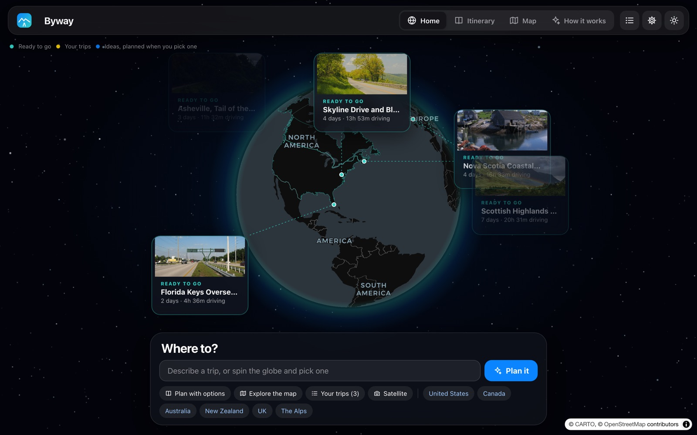

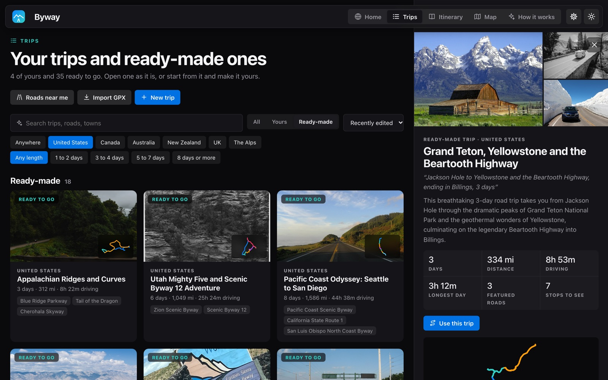

**Trips**: your own and the 38 ready-made ones, with search and filters, and a preview of every day before you open one.

| | |
|---|---|
| 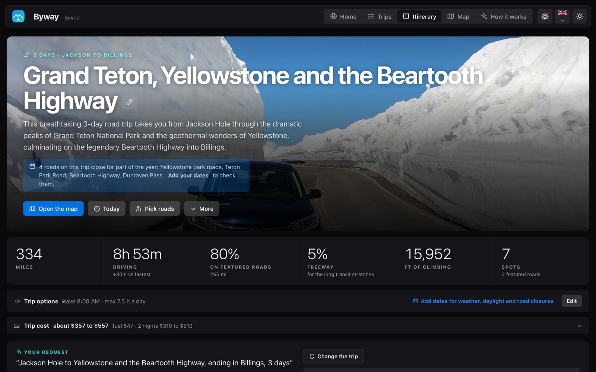 | 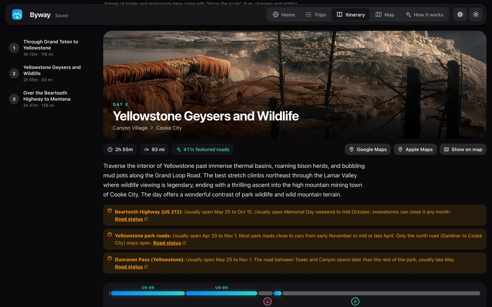 |
| **A trip at a glance**: miles, hours, featured roads, climbing and stops. | **Every day**: the drive, the guide, closures and winter rules. |
| 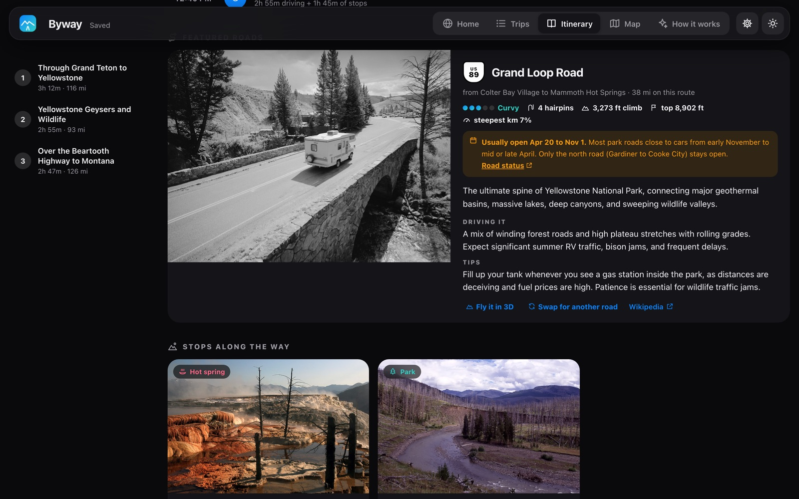 | 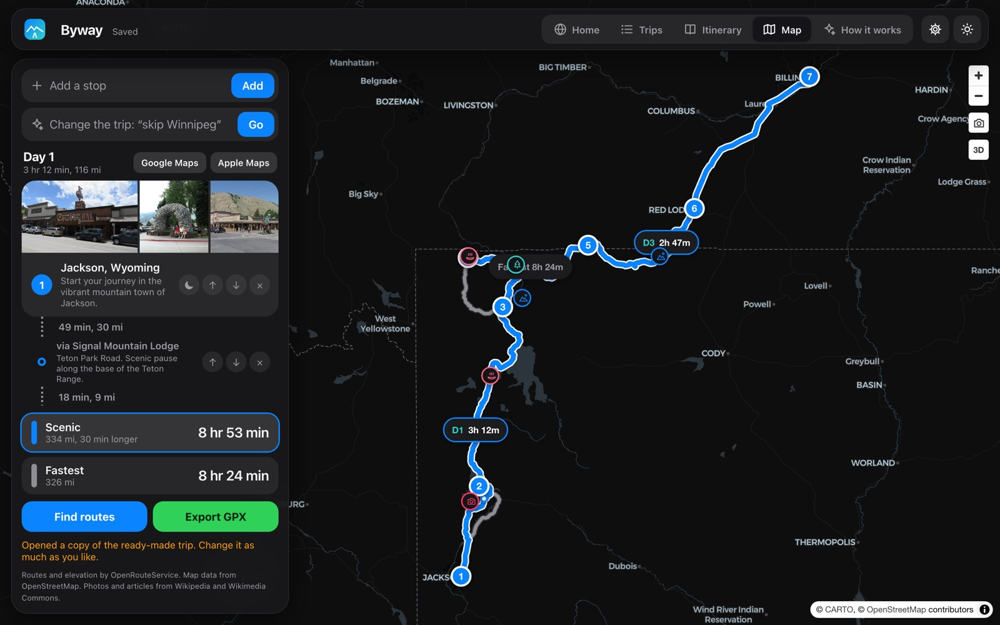 |
| **Featured roads**, rated for curves, hairpins and climbs. | **The map**, with each day's time and the stops. |
| 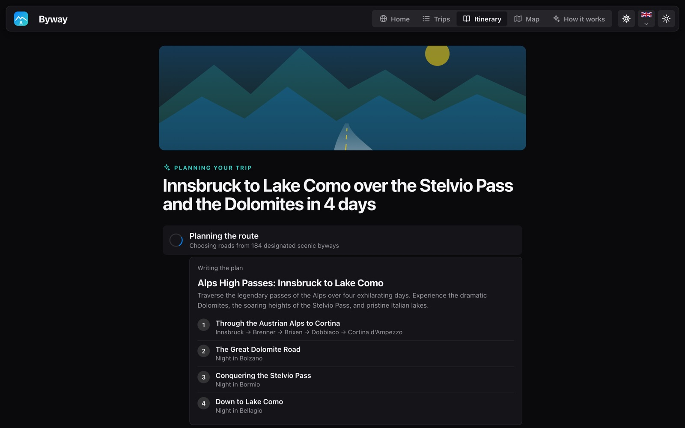 | 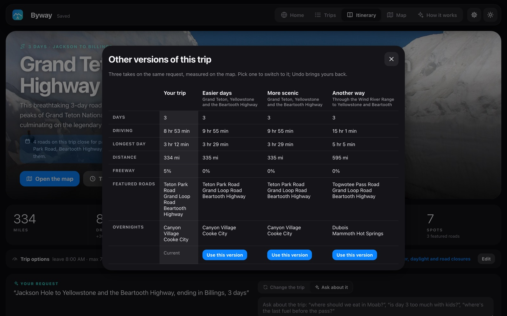 |
| **Planning live**: the days fill in as the AI writes them. | **Other versions**, measured and compared before you switch. |
| 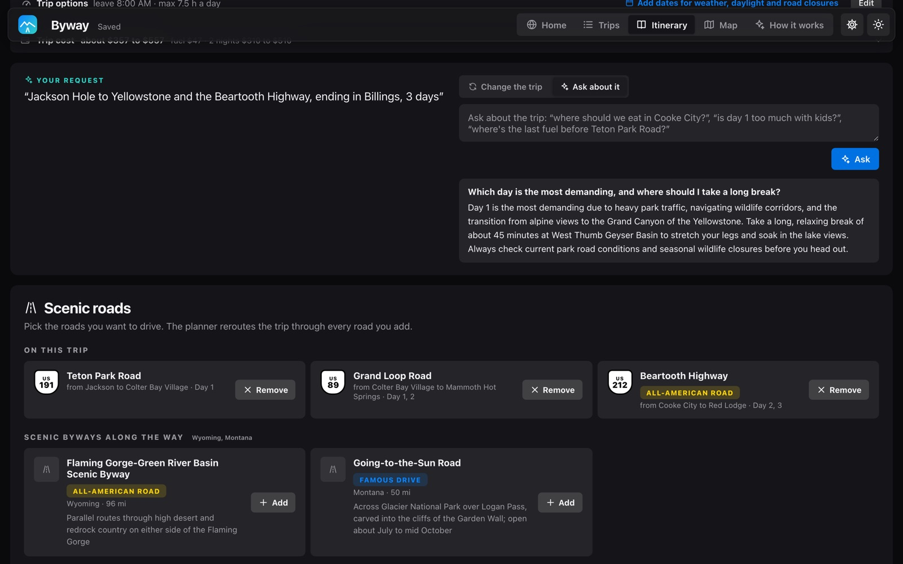 | 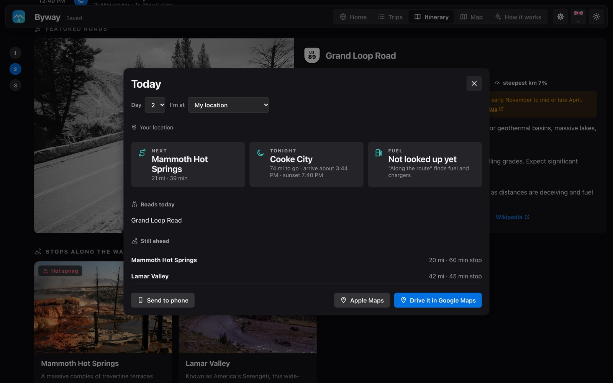 |
| **Ask your trip**, answered from its own days and places. | **Today**: what's next while you're on the road. |
| 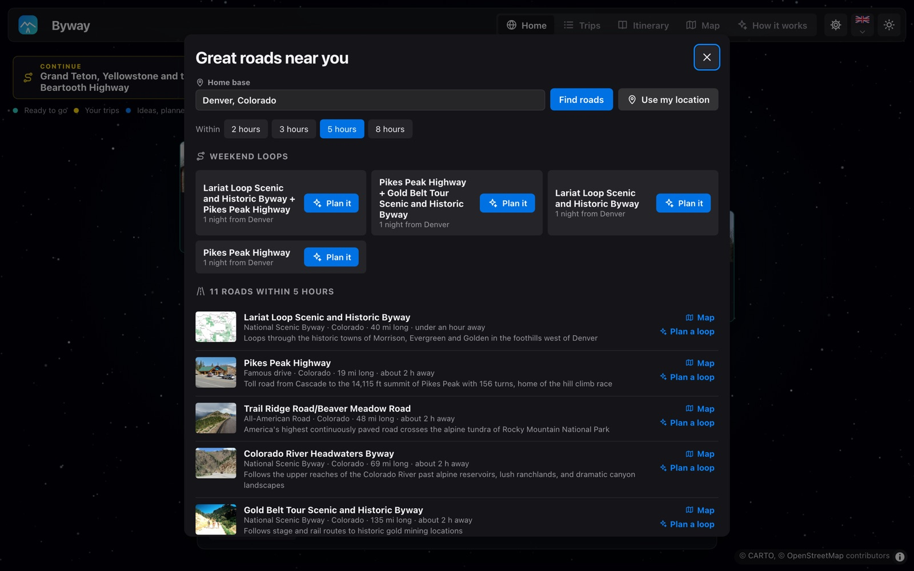 | 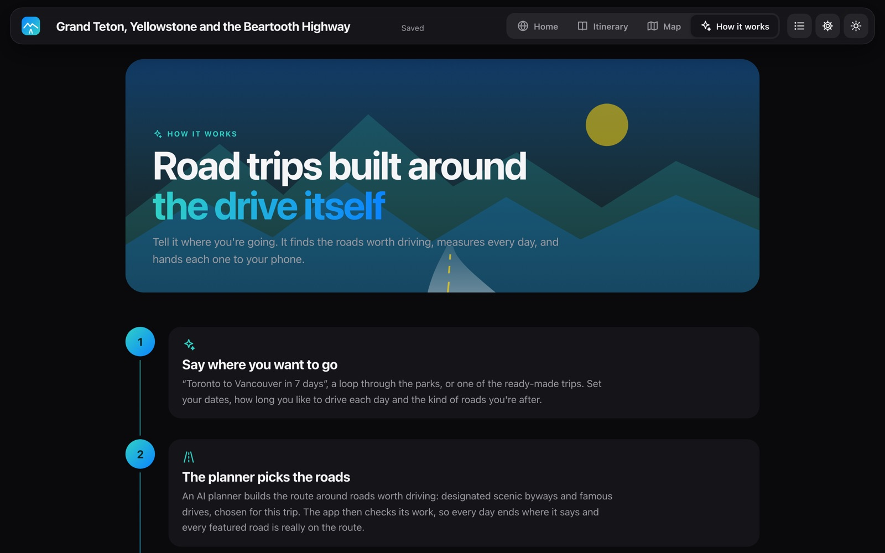 |
| **Roads near me**: the byways and famous drives within a few hours, and weekend loops in one tap. | **How it works**, a short tour in the app. |

  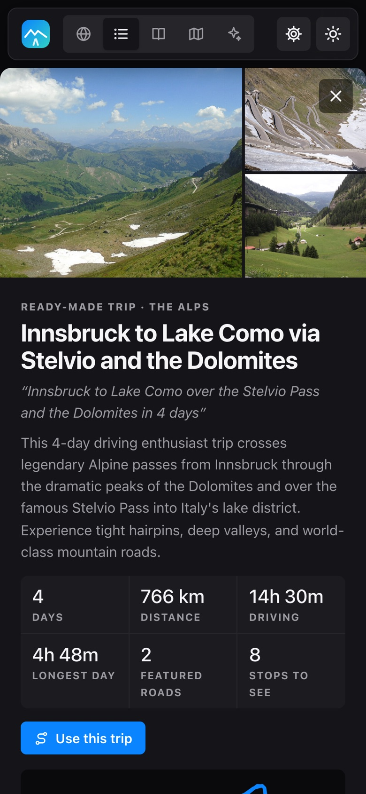
  &nbsp;
  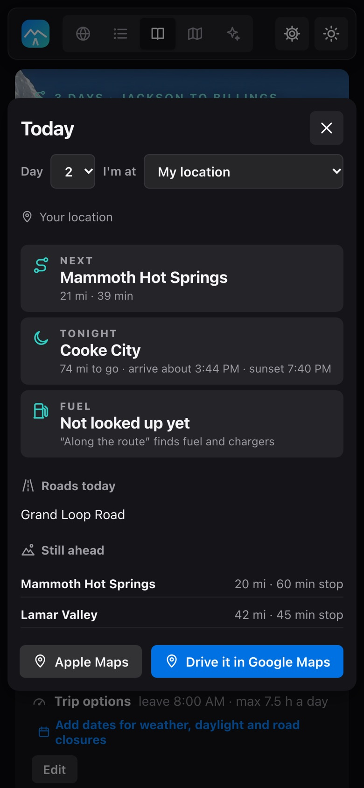

## Getting started

**The desktop app** is the easiest way: download it from the [Releases](../../releases) page (Mac: the `.dmg`, Apple
Silicon; Windows: `Byway Setup`), open it, and the welcome screen walks you through the rest. The apps aren't signed:
on a Mac, right-click the app and choose Open the first time; on Windows, "More info", then "Run anyway".

**Or run it from the source code:**

1. Install [Node.js](https://nodejs.org/en/download) (free, the LTS version).
2. Mac: double-click `start.command` (the first time, macOS may refuse it as coming from an unidentified developer:
   right-click it, choose Open, then Open). Windows: double-click `start.cmd`. Linux, or a Mac from Terminal: `sh start.sh`.
   The first time it installs what the app needs (about a minute), then opens the app in your browser.
3. That's enough to open the 38 ready-made trips, browse them and change them on the map. To plan your own, open
   Setup (the gear button, or "add a free AI planner" on the home screen); it walks you through the rest, all free:
   - an [OpenRouteService](https://openrouteservice.org/dev/#/signup) key for measuring routes (recommended, no card;
     without it, or when its daily allowance runs out, routes come from OpenStreetMap's public OSRM servers, with
     heights from Open-Meteo),
   - the trip planner AI: a free [Google Gemini](https://aistudio.google.com/apikey) key (Flash-Lite: a plan in a few
     seconds, no graphics card needed), or a model on your own computer with [LM Studio](https://lmstudio.ai)
     (unlimited and private, needs about 8 GB of graphics memory or an Apple Silicon Mac; Setup can start it, download
     the model and load it),
   - a [Tavily](https://app.tavily.com) key for web search while planning, and for "What drivers say" on road cards
     (optional),
   - your email or website, so Wikipedia and OpenStreetMap don't slow down lookups (recommended).

Setup checks each key with its service before saving it to `.env` (see `.env.example`). It's the gear button in the
top bar and only works on the computer running the app. Keep the start window open while you use the app.

## What it does

- **Plan**: describe the trip, or pick a style (coast, mountains, twisty roads...), dates, when you leave, the longest
  day you want, a loop, no night driving, an electric car. Or open one of the 38 ready-made trips instantly. The plan
  fills in on screen as the AI writes it, and the app checks it (days, overnights, featured roads on the route) and
  sends problems back once.
- **Every day**: driving time and distance, weather, sunset, a timeline with the roads and stops, a drive chart (climbs,
  featured roads and the clock along the day, linked to the timeline),
  seasonal closures, ferries, tolls and gravel, featured road cards with curve and climb ratings, stops with photos,
  fuel and charger gaps, and places to stay and eat at the overnight with booking searches for that night.
- **Change it in plain words**: "skip Winnipeg", "add a night in Banff". Changes apply in place with Undo. Fix long
  days moves the overnights first and only asks the AI when that isn't enough.
- **Ask your trip**: "where should we eat in Moab?" Answers come from the trip's own days, stops and places, and a
  suggested change can be applied with one tap.
- **Other versions**: easier, more scenic or another way, measured and compared side by side.
- **Edit on the map**: drag a stop, pull the route through a town, right-click or long-press to add a place.
- **Today**: on the road, what's next, the next fuel or charger, roads and stops ahead, and arrival against sunset.
- **Send to your phone**: a QR code per day opens it in Google Maps or Apple Maps; long days go in parts so every
  scenic via point makes it.
- **Trip cost**: fuel or charging per day and lodging per night, in the trip's own units and currency.
- **Roads near me**: the scenic byways and famous drives within a few hours of home, with weekend loops to plan.
- **What drivers say**: on each featured road, a short summary of what drivers write about it (with a web search key).
- **Trips**: your trips and the ready-made ones in one tab, with search, region and length filters, and a preview of
  every day, the route and the roads before you open one.
- **Export and share**: GPX, print or PDF, a web page, or a read-only link for devices on the same network.
- **Import a GPX file** (Trips tab): a Byway export comes back as it was; a route, waypoints or a recorded track from
  another app becomes a trip, measured and split into days.
- **How it works**: a short tour in the top bar, with an "In depth" version on the methods behind each step.
- **Welcome screen**: the first time it opens, a few skippable steps (language, sound, the AI planner,
  your home town). Setup can show it again. It opens on a satellite view of your town (or San Francisco) and pulls back
  to the globe. Dark and satellite are the defaults; both switch from the top bar and the map.
- **Languages**: English, French, Chinese (simplified) and Bangla, from the flag next to the light/dark switch. The
  AI writes plans and guides in the chosen language; place and road names stay as maps know them. Most screens are
  translated; less-used sheets are still in English.
- **Sound**: soft interface sounds and ambient music on the globe, made in the browser (no audio files), each with an
  on/off switch and volume in Settings.

## Desktop app

`npm run desktop` opens Byway in its own window (Electron) instead of the browser, with the server inside it. Trips, keys
and caches are kept in the app's data folder (Mac: `~/Library/Application Support/Byway`, Windows: `%APPDATA%\Byway`).
`npm run desktop:build` makes the installers in `dist/`, and the "Desktop apps" workflow in GitHub Actions builds them for Mac and Windows when started by hand or by a version tag. The apps aren't signed: right-click, Open the first time
on a Mac; "More info", "Run anyway" on Windows.

## On your phone

- **At home**: Setup's "On your phone" shows the app's address on your network with a QR code. Open it in Safari or
  Chrome on a phone on the same Wi-Fi; on an iPhone, Share, then Add to Home Screen, makes it open like an app.
  The computer has to be on with the app running.
- **Away from home, offline use and location in Today**: these need a secure (https) address. A free way is
  [Tailscale](https://tailscale.com): install it on the computer and the phone, sign in on both, then run
  `tailscale serve --bg 3000` on the computer and open the `https://...ts.net` address it shows on the phone.

## Data and tools

- `data/byways.json`: US National Scenic Byways and All-American Roads (`node tools/build-byways.mjs`).
- `data/*-drives.json`: hand-picked drives (US extras, Canada, Australia, New Zealand, UK, Alps).
  `node tools/check-drives.mjs` checks every Wikipedia title.
- `public/seasonal-roads.json`: roads that close for winter or need chains. `node tools/check-seasonal.mjs` checks the
  coordinates against OpenStreetMap.
- `public/coverage.json`: covered regions and the grey mask (`node tools/build-coverage.mjs`, needs `@turf/turf`).
- `public/i18n-strings.js`: the translations (English text to French, Chinese and Bangla). A line per piece of text;
  anything without one stays in English.
- `data/presets.json`: the ready-made trips. Build them with batch mode (`http://localhost:3000/?batch=1`, trips
  already built are skipped), then `node tools/export-presets.mjs`.
- `node tools/package.mjs` builds a zip like a GitHub download.
- `npm test`: unit tests for the trip logic. `npm run smoke` (needs `CHROME_PATH`): every view and sheet in headless
  Chrome, the welcome screen and a pass in Bangla. `node tools/audit-trips.mjs`: checks every ready-made trip.
- `npm run eval`: the planner eval, 30 trip requests through each AI model and the app's pipeline, with a
  stage-by-stage report (`eval/README.md`).
- Saved trips store their route lines as encoded polylines (about 1 m precision) to keep files small.
- Your trips (`data/trips.json`), keys (`.env`) and caches (routes, places, weather, photos, searches) stay on your
  computer and out of git.

## GraphHopper (optional, off by default)

A self-hosted GraphHopper can fine-tune routes inside one region. It needs Java, a lot of RAM and a long first build,
so the app doesn't need it. To use it, download a region from Geofabrik and the GraphHopper jar, set
`USE_GRAPHHOPPER=1` in `.env` and run `graphhopper/start-graphhopper.cmd`.

## Privacy, terms and license

The app has no accounts, analytics or ads; see the [privacy policy](public/privacy.html) for what each outside service
receives, and the [terms of use](public/terms.html). Map data © OpenStreetMap contributors (ODbL); the dark base map
(CARTO) and the Sentinel-2 satellite layer (EOX) are for non-commercial use. The code is under the MIT License
([LICENSE](LICENSE)).
